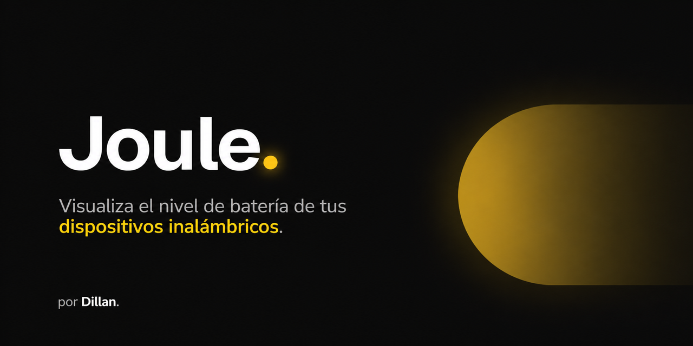

<h1 align="center"></h1>

<p align="center"><strong>Batería de tus dispositivos inalámbricos —ratón, auriculares, mando y teclado— en el área de notificación de Windows.</strong></p>

<p align="center">
  <a href="https://github.com/DillanCidral/Joule/releases/latest"></a>
  <a href="https://github.com/DillanCidral/Joule/releases"></a>
  
  <a href="LICENSE"></a>
</p>

<p align="center"> <strong>Español</strong> · <a href="README.md"> English</a> · <a href="README.pt-BR.md"> Português</a> · <a href="README.fr.md"> Français</a> · <a href="README.ru.md"> Русский</a> · <a href="README.zh-TW.md"> 繁體中文</a></p>

<p align="center">
  <a href="https://github.com/DillanCidral/Joule/releases/latest/download/JouleApp-win-Setup.exe"></a>
</p>

<p align="center"></p>

Joule es una pequeña aplicación para Windows 11 que se mantiene en el área de notificación y muestra cuánta batería les queda a tus dispositivos inalámbricos. Es gratuita, de código abierto y está en
**fase beta**.

## Qué incluye

- **Panel**: haz clic en el icono del área de notificación para ver todos los dispositivos conectados, empezando por el que tiene menos batería.
- **Widget en el borde**: muestra anillos de batería junto al borde de la pantalla. Se oculta y deja de estorbar cuando usas aplicaciones a pantalla completa.
- **Icono del área de notificación**: indica de un vistazo si algún dispositivo tiene poca batería; pasa el cursor por encima para ver el nivel de cada uno.
- **Aviso al conectar**: cuando enciendes un dispositivo, Joule muestra su nivel de batería en el widget o mediante una notificación de Windows, con sonido si así lo prefieres.
- **Alerta de batería baja**, con el límite que tú elijas.
- **Inglés, portugués, francés y ruso**: Joule sigue el idioma de Windows y puedes cambiarlo en Configuración. Personas que usan Joule tradujeron el francés y el ruso.
- **Indicador verde al completar la carga**: los dispositivos que informan que están cargando se muestran en verde en el widget y en el área de notificación al llegar al 100 %.
- **Resumen después de actualizar**: muestra cuántos dispositivos registró Joule y cuántas alertas de batería baja emitió. Estos datos se cuentan solo en tu PC e incluyen los cambios de la versión.

## Descarga

Descarga `JouleApp-win-Setup.exe` con el botón de arriba o desde la
[página de versiones](https://github.com/DillanCidral/Joule/releases) y ejecútalo.

- No necesitas permisos de administrador. Se instala solo para tu cuenta y aparece en *Aplicaciones instaladas*, desde donde puedes desinstalarlo.
- El instalador no tiene firma digital, así que Windows SmartScreen mostrará una advertencia. Haz clic en **Más información** y luego en **Ejecutar de todas formas**.
- Joule se actualiza desde las versiones de GitHub y te avisa en el área de notificación cuando hay una versión nueva lista.

## Dispositivos compatibles

| Dispositivo | Conexión | Estado |
|---|---|---|
| Attack Shark R1 | dongle | ✅ probado |
| Rapoo MT760 Mini | dongle | ✅ probado |
| ATK 1K DONGLE-PAW | dongle | ✅ probado |
| ATK Mercury I / M1, receptor `0005` y auriculares `0007` | dongle | ✅ probado |
| Razer BlackShark V3 | dongle | ✅ probado |
| Zaopin ZPW MAX (8K) | dongle | ✅ probado |
| Receptor AJAZZ 2.4G 8K | dongle | ✅ probado |
| AULA F75 | cable | ✅ probado |
| DualSense | cable | ✅ probado |
| DualSense por Bluetooth, DualShock 4 | cable, Bluetooth (con Steam o un programa similar abierto) | 🧪 aún no probado |
| Controles Xbox | adaptador y cable | ✅ probado |
| 8BitDo Ultimate 2C | cable | ✅ probado |
| Cualquier dispositivo Bluetooth cuya batería ya muestre Windows en *Configuración > Bluetooth* | Bluetooth | ✅ probado |
| Ratones Logitech con LIGHTSPEED (PRO X 2 y otros) y Unifying (MX Master 2S), SteelSeries Arctis 1 y Arctis 7, VXE R1 Pro Max, VGN IO Aurora, AULA AU75, Razer Basilisk V3 Pro 35K, SteelSeries Arctis Nova 7 Gen 2, Lamzu Maya X, Dark Project Novus, HyperX Cloud Alpha 2 Wireless, AULA F75 (dongle), Pulsar TenZ, SteelSeries Arctis Nova 3P/3X, Logitech G733 | dongle | ✅ confirmado por usuarios |
| Logitech, Razer, SteelSeries, HyperX y Corsair: ratones, teclados y auriculares | dongle | 🧪 aún no probado |
| Unas 20 marcas más: ATK, VXE, VGN, Pulsar, Dareu, AJAZZ, Lamzu, WLmouse, G-Wolves, Hitscan, K-Snake, Bytech, Motospeed, Keychron, Incott y más modelos de Attack Shark | dongle | 🧪 aún no probado |

🧪 significa que la compatibilidad se documentó con protocolos públicos, pero aún no se ha probado en un dispositivo real. Si tienes uno, tu reporte ayudará a confirmarla. “Confirmado por usuarios” significa que alguien envió una captura de Joule leyéndolo en su propia PC. Consulta la lista completa en [docs/supported-devices.md](docs/supported-devices.md).

## Mi dispositivo no aparece

Primero revisa las [familias de dispositivos](https://github.com/DillanCidral/Joule/issues?q=is%3Aissue%20is%3Aopen%20label%3Atracking). Si el tuyo aparece, dale 👍 en lugar de abrir un reporte nuevo. Joule también muestra solicitudes similares cuando envías una.

En Joule, abre **Configuración > Avanzado > Enviar un dispositivo**. La aplicación recopila datos durante 30 segundos mientras usas el dispositivo, muestra lo que encontró, elimina los datos personales (número de serie, dirección Bluetooth, nombre de la PC y nombre de usuario) y guarda un archivo `.txt`. Después, tú envías ese archivo mediante un [reporte en GitHub](https://github.com/DillanCidral/Joule/issues/new/choose) o por [correo electrónico](#contact). El archivo no sale de tu PC por sí solo.

¿Quieres agregar el dispositivo tú mismo? Consulta [docs/adding-a-device.md](docs/adding-a-device.md).

<details>
<summary><strong>Qué hace Joule con tus dispositivos</strong></summary>

- Lee los niveles cuando abres la aplicación, inicias sesión en Windows, haces clic en **Actualizar**, conectas o enciendes un dispositivo (solo consulta ese dispositivo, como máximo una vez cada 10 segundos) y abres el panel si la última lectura tiene más de una hora. No consulta los dispositivos en un ciclo continuo.
- Con la mayoría de los dispositivos, solo **escucha** los datos que ya envía el dongle o el cable, o lee el nivel que Windows guardó (Bluetooth).
- Con algunas marcas conectadas mediante dongle (Logitech, Razer, SteelSeries, HyperX, Corsair y algunas otras), Joule **consulta** la batería del dispositivo solo después de que autorizas esa marca. Envía una vez por lectura la misma consulta que usan proyectos de código abierto como Solaar, OpenRazer y HeadsetControl. Nunca envía comandos que cambien una configuración. La opción **Solo escuchar** en Configuración desactiva todas las consultas.
- Nunca muestra un nivel que no haya leído. “Sin datos” significa que no hay datos, nunca “0 %”.
- No envía nada a ningún sitio. Su único acceso a la red es para buscar actualizaciones en GitHub Releases.

Detalles: [SECURITY.md](SECURITY.md).

</details>

<details>
<summary><strong>Compilar desde el código fuente</strong></summary>

Necesitas Windows y el [SDK de .NET 8](https://dotnet.microsoft.com/download/dotnet/8.0).

```bash
dotnet build src/BatteryTray -c Debug
```

```bash
dotnet run --project src/BatteryTray -- --demo
```

`--demo` muestra dispositivos de ejemplo sin interactuar con ningún equipo real. Consulta también [CONTRIBUTING.md](CONTRIBUTING.md) y [docs/architecture.md](docs/architecture.md).

</details>

## Agradecimientos

La versión 0.2.3 incluye código y traducciones de [@DiogoLss](https://github.com/DiogoLss) (ATK 1K DONGLE-PAW y Mercury I / M1), [@BatuhanUyurca](https://github.com/BatuhanUyurca) (ATK A9 Ultra V2), [@Ali-Fani](https://github.com/Ali-Fani) (Attack Shark V6), [@mochi0820](https://github.com/mochi0820) (chino tradicional), [@TukaLeHibou](https://github.com/TukaLeHibou) (revisión de la traducción al francés) y [@wrldwideme](https://github.com/wrldwideme) (README en ruso). El formato del reloj surgió de una idea de Yim.

La versión 0.2.1 incluye código y traducciones de la comunidad: [@Ali-Fani](https://github.com/Ali-Fani) (Razer BlackShark V3), [@wrldwideme](https://github.com/wrldwideme) (AULA F75, los receptores AJAZZ y Zaopin, y la traducción al ruso) y [@TukaLeHibou](https://github.com/TukaLeHibou) (traducción al francés). El indicador verde de batería llena surgió de una idea de Daniel Palma. Gracias también a todas las personas que enviaron capturas.

## Apoya a Joule

Joule es gratis y de código abierto. Si te sirve, un café ayuda a mantenerlo así: [apoya a Joule](https://buy.stripe.com/bJeeVe5yq5Pub7bfz8bZe00).

## Contacto

- Correo electrónico: dillan.apps@gmail.com
- Instagram: [@dillan.apps](https://www.instagram.com/dillan.apps/)
- YouTube: [@dillanapps](https://www.youtube.com/@dillanapps)

## Licencia

[AGPL-3.0](LICENSE). Las licencias de terceros y los proyectos de código abierto cuya documentación de protocolos hizo posible Joule se enumeran en [THIRD-PARTY-NOTICES.md](THIRD-PARTY-NOTICES.md).

Joule no está afiliado con Logitech, Razer, SteelSeries, HyperX, Corsair, Sony, Microsoft, 8BitDo ni ninguna otra marca mencionada aquí. Sus nombres y marcas registradas pertenecen a sus respectivos propietarios.
