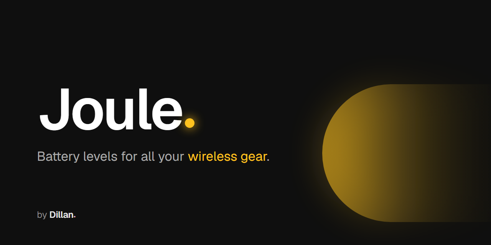

<h1 align="center"></h1>

<p align="center"><strong>La batterie de votre souris, casque, manette et clavier sans fil, dans la zone de notification de Windows.</strong></p>

<p align="center">
  <a href="https://github.com/DillanCidral/Joule/releases/latest"></a>
  <a href="https://github.com/DillanCidral/Joule/releases"></a>
  
  <a href="LICENSE"></a>
</p>

<p align="center"><a href="README.md"> English</a> · <a href="README.pt-BR.md"> Português</a> ·  <strong>Français</strong> · <a href="README.ru.md"> Русский</a> · <a href="README.zh-TW.md"> 繁體中文</a></p>

<p align="center">
  <a href="https://github.com/DillanCidral/Joule/releases/latest/download/JouleApp-win-Setup.exe"></a>
</p>

<p align="center"></p>

Joule est une petite application Windows 11 qui reste dans la zone de
notification et indique la batterie restante de vos appareils sans fil. Elle
est gratuite, open source et en **bêta**.

## Ce que vous obtenez

- **Panneau** : cliquez sur l'icône pour voir tous les appareils connectés, le
  plus faible en premier.
- **Widget de bord** : des anneaux de batterie sur le bord de l'écran. Il se
  masque tout seul et s'efface devant les applications en plein écran.
- **Icône** : montre d'un coup d'œil si une batterie est faible ; survolez-la
  pour voir la batterie de chaque appareil.
- **Avis de connexion** : quand un appareil s'allume, Joule affiche sa
  batterie, sur le widget ou en notification Windows, avec un son si vous le
  souhaitez.
- **Alerte de batterie faible**, avec un seuil que vous choisissez.
- **Français, anglais, portugais et russe** : suit la langue de Windows, et vous
  pouvez en changer dans les Paramètres.
- **Batterie pleine en vert** : un appareil en charge passe au vert sur le widget
  et dans la zone de notification dès qu'il atteint 100 %.
- **Résumé après mise à jour** : combien d'appareils Joule a suivis et combien
  d'alertes de batterie faible il a données, compté uniquement sur votre PC,
  ainsi que les nouveautés de la version.

## Téléchargement

Récupérez `JouleApp-win-Setup.exe` avec le bouton ci-dessus ou depuis la
[page Releases](https://github.com/DillanCidral/Joule/releases), puis
lancez-le.

- Aucun droit administrateur requis. Il s'installe pour votre utilisateur
  uniquement et apparaît dans *Applications installées*, d'où vous pouvez le
  supprimer.
- L'installeur n'est pas signé numériquement, Windows SmartScreen affichera
  donc un avertissement. Cliquez sur **Informations complémentaires**, puis
  **Exécuter quand même**.
- Joule se met à jour depuis GitHub Releases et vous prévient dans la zone de
  notification quand une nouvelle version est prête.

## Appareils pris en charge

| Appareil | Connexion | État |
|---|---|---|
| Attack Shark R1 | dongle | ✅ vérifié |
| Rapoo MT760 Mini | dongle | ✅ vérifié |
| ATK 1K DONGLE-PAW | dongle | ✅ vérifié |
| ATK Mercury I / M1 | dongle | ✅ vérifié |
| Razer BlackShark V3 | dongle | ✅ vérifié |
| Zaopin ZPW MAX (8K) | dongle | ✅ vérifié |
| Récepteur AJAZZ 2,4 GHz 8K | dongle | ✅ vérifié |
| AULA F75 | câble | ✅ vérifié |
| DualSense | câble | ✅ vérifié |
| DualSense en Bluetooth, DualShock 4 | câble, Bluetooth (avec Steam ou un programme similaire ouvert) | 🧪 pas encore testé |
| Manettes Xbox | adaptateur et câble | ✅ vérifié |
| 8BitDo Ultimate 2C | câble | ✅ vérifié |
| Tout appareil Bluetooth dont Windows affiche déjà la batterie dans *Paramètres > Bluetooth* | Bluetooth | ✅ vérifié |
| Souris Logitech en LIGHTSPEED (PRO X 2 et autres) et Unifying (MX Master 2S), casques SteelSeries Arctis 1 et Arctis 7, VXE R1 Pro Max, VGN IO Aurora, AULA AU75, Razer Basilisk V3 Pro 35K, SteelSeries Arctis Nova 7 Gen 2, Lamzu Maya X, Dark Project Novus, HyperX Cloud Alpha 2 Wireless, AULA F75 (dongle), Pulsar TenZ, SteelSeries Arctis Nova 3P/3X, Logitech G733 | dongle | ✅ confirmé par des utilisateurs |
| Logitech, Razer, SteelSeries, HyperX et Corsair : souris, claviers et casques | dongle | 🧪 pas encore testé |
| Une vingtaine d'autres marques : ATK, VXE, VGN, Pulsar, Dareu, AJAZZ, Lamzu, WLmouse, G-Wolves, Hitscan, K-Snake, Bytech, Motospeed, Keychron, Incott et d'autres modèles Attack Shark | dongle | 🧪 pas encore testé |

🧪 signifie écrit d'après une documentation de protocole ouverte et pas encore
testé sur du matériel réel. Si vous en possédez un, c'est votre retour qui le
confirme. Liste complète (en anglais) :
[docs/supported-devices.md](docs/supported-devices.md).

## Mon appareil n'est pas dans la liste

Regardez d'abord les [familles d'appareils](https://github.com/DillanCidral/Joule/issues?q=is%3Aissue%20is%3Aopen%20label%3Atracking) : si le vôtre y est,
donnez-lui un 👍 au lieu d'ouvrir une nouvelle demande.

Ouvrez **Paramètres > Avancé > Envoyer un appareil** dans Joule. Il écoute pendant
30 secondes pendant que vous utilisez l'appareil, vous montre ce qu'il a
trouvé, retire les données personnelles (numéro de série, adresse Bluetooth,
nom du PC, nom d'utilisateur) et enregistre un `.txt`. Vous envoyez ensuite ce
fichier vous-même, sous forme d'
[issue GitHub](https://github.com/DillanCidral/Joule/issues/new/choose) ou par
[e-mail](#contact). Rien ne quitte votre PC tout seul.

Vous voulez ajouter l'appareil vous-même ? Voir
[docs/adding-a-device.md](docs/adding-a-device.md) (en anglais).

<details>
<summary><strong>Ce que Joule fait à vos appareils</strong></summary>

- Il lit à l'ouverture de l'application, à l'ouverture de session Windows,
  quand vous cliquez sur **Actualiser**, quand vous branchez ou allumez un
  appareil (uniquement cet appareil, au plus une fois toutes les 10 secondes)
  et quand vous ouvrez le panneau si la dernière lecture date de plus d'une heure.
  Il n'interroge jamais en boucle.
- Pour la plupart des appareils, il se contente d'**écouter** ce que le dongle
  ou le câble envoie déjà, ou de lire le chiffre que Windows a lui-même
  enregistré (Bluetooth).
- Pour certaines marques sur dongle (Logitech, Razer, SteelSeries, HyperX,
  Corsair et une partie des autres), il **demande** sa batterie à l'appareil,
  uniquement après que vous avez autorisé cette marque : la même question que
  celle envoyée par des projets ouverts comme Solaar, OpenRazer et
  HeadsetControl, une fois par lecture. Il n'envoie jamais de commande qui
  modifie un réglage. L'interrupteur **Écoute seule** des Paramètres désactive
  toutes les questions.
- Il n'affiche jamais un chiffre qu'il n'a pas lu. Pas de données, c'est
  « pas de données », jamais « 0 % ».
- Il n'envoie rien nulle part. Le seul accès réseau est la recherche de mise à
  jour sur GitHub Releases.

Détails (en anglais) : [SECURITY.md](SECURITY.md).

</details>

<details>
<summary><strong>Compiler depuis les sources</strong></summary>

Il vous faut Windows et le [SDK .NET 8](https://dotnet.microsoft.com/download/dotnet/8.0).

```bash
dotnet build src/BatteryTray -c Debug
```

```bash
dotnet run --project src/BatteryTray -- --demo
```

`--demo` affiche des appareils d'exemple sans toucher au matériel. Plus
d'informations (en anglais) dans [CONTRIBUTING.md](CONTRIBUTING.md) et
[docs/architecture.md](docs/architecture.md).

</details>

## Merci

La version 0.2.3 apporte du code et des traductions de [@DiogoLss](https://github.com/DiogoLss) (ATK 1K DONGLE-PAW
et Mercury I / M1), [@BatuhanUyurca](https://github.com/BatuhanUyurca) (ATK A9 Ultra V2), [@Ali-Fani](https://github.com/Ali-Fani) (Attack Shark V6),
[@mochi0820](https://github.com/mochi0820) (chinois traditionnel), [@TukaLeHibou](https://github.com/TukaLeHibou) (français révisé) et [@wrldwideme](https://github.com/wrldwideme)
(README russe), et le format de l'heure vient d'une idée de Yim.

La version 0.2.1 contient du code et des traductions de la communauté :
[@Ali-Fani](https://github.com/Ali-Fani) (Razer BlackShark V3),
[@wrldwideme](https://github.com/wrldwideme) (AULA F75, récepteurs AJAZZ et
Zaopin, traduction russe),
[@TukaLeHibou](https://github.com/TukaLeHibou) (traduction française), et le
vert de la batterie pleine vient d'une idée de Daniel Palma. Merci à tous ceux
qui ont envoyé une capture.

## Soutenir Joule

Joule est gratuit et open source. S'il vous est utile, un café aide à ce que
ça continue : [soutenir Joule](https://buy.stripe.com/bJeeVe5yq5Pub7bfz8bZe00).

## Contact

- E-mail : dillan.apps@gmail.com
- Instagram : [@dillan.apps](https://www.instagram.com/dillan.apps/)
- YouTube : [@dillanapps](https://www.youtube.com/@dillanapps)

## Licence

[AGPL-3.0](LICENSE). Les licences tierces et les projets ouverts dont la
documentation de protocole a rendu Joule possible sont listés dans
[THIRD-PARTY-NOTICES.md](THIRD-PARTY-NOTICES.md).

Joule n'est affilié ni à Logitech, Razer, SteelSeries, HyperX, Corsair, Sony,
Microsoft, 8BitDo, ni à aucune autre marque mentionnée ici. Leurs noms et
marques appartiennent à leurs propriétaires.
