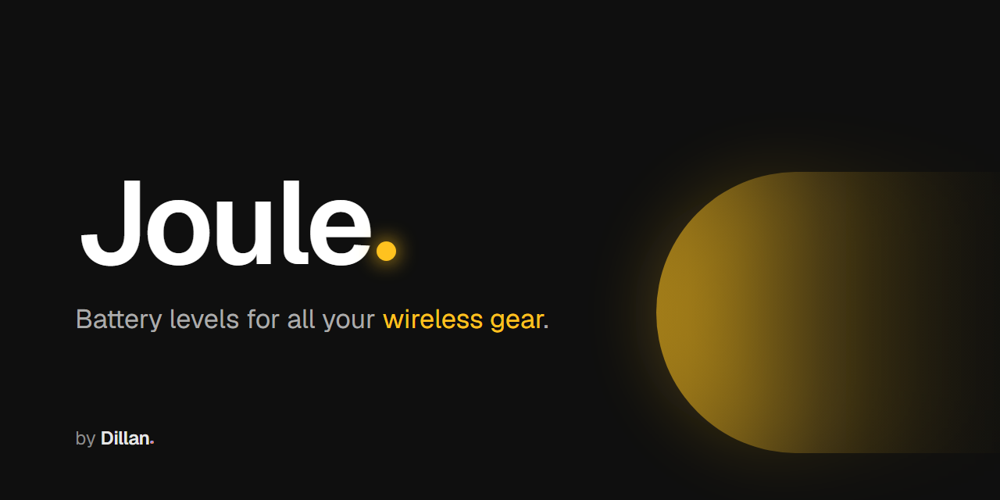
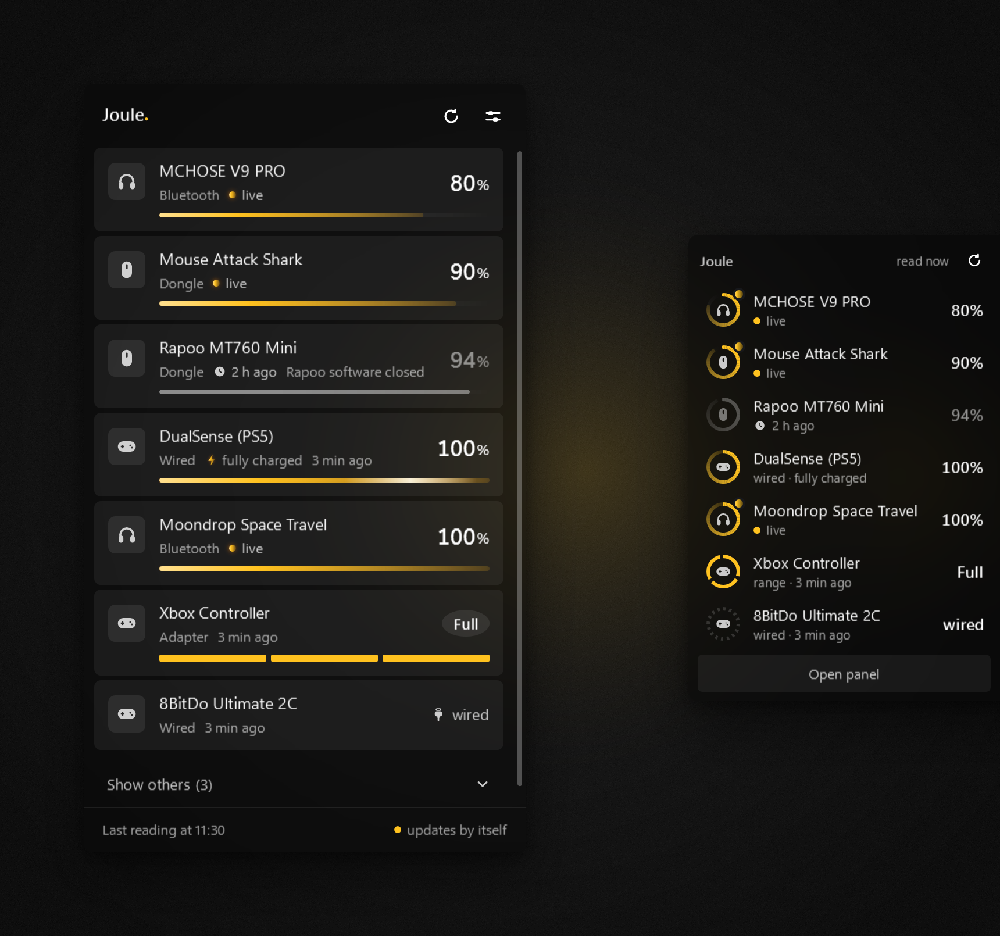

<h1 align="center"></h1>

<p align="center"><strong>Battery for your wireless mouse, headset, controller and keyboard, in the Windows tray.</strong></p>

<p align="center">
  <a href="https://github.com/DillanCidral/Joule/releases/latest"></a>
  <a href="https://github.com/DillanCidral/Joule/releases"></a>
  
  <a href="LICENSE"></a>
</p>

<p align="center"> <strong>English</strong> · <a href="README.pt-BR.md"> Português</a></p>

<p align="center">
  <a href="https://github.com/DillanCidral/Joule/releases/latest/download/JouleApp-win-Setup.exe"></a>
</p>

<p align="center"></p>

Joule is a small Windows 11 app that sits in the tray and shows how much
battery your wireless devices have left. It is free, open source and in
**beta**.

## What you get

- **Panel**: click the tray icon to see every connected device, weakest first.
- **Edge widget**: battery rings on the edge of the screen. It hides itself and
  gets out of the way of full-screen apps.
- **Tray icon**: shows at a glance whether anything is running low; hover to
  see each device's battery.
- **Connect notice**: when a device turns on, Joule shows its battery, on the
  widget or as a Windows notification, with sound if you want.
- **Low battery alert**, with a limit you choose.
- **English and Portuguese**: follows the Windows language, and you can switch
  in Settings.
- **Summary after updating**: how many devices Joule tracked and how many
  low-battery warnings it gave, counted only on your PC, plus what changed in
  the version.

## Download

Get `JouleApp-win-Setup.exe` with the button above or from the
[Releases page](https://github.com/DillanCidral/Joule/releases), and run it.

- No administrator rights needed. It installs for your user only and shows up
  in *Installed apps*, where you can remove it.
- The installer is not digitally signed, so Windows SmartScreen will warn you.
  Click **More info**, then **Run anyway**.
- Joule updates itself from GitHub Releases and tells you in the tray when a
  new version is ready.

## Supported devices

| Device | Connection | Status |
|---|---|---|
| Attack Shark R1 | dongle | ✅ checked |
| Rapoo MT760 Mini | dongle | ✅ checked |
| DualSense | cable | ✅ checked |
| Xbox controllers | adapter and cable | ✅ checked |
| 8BitDo Ultimate 2C | cable | ✅ checked |
| Any Bluetooth device whose battery Windows already shows in *Settings > Bluetooth* | Bluetooth | ✅ checked |
| Logitech, Razer, SteelSeries, HyperX and Corsair: mice, keyboards and headsets | dongle | 🧪 not tested yet |
| About 20 other brands: ATK, VXE, VGN, Pulsar, Dareu, AJAZZ, Lamzu, WLmouse, G-Wolves, Hitscan, K-Snake, Bytech, Motospeed, Keychron, Incott and more Attack Shark models | dongle | 🧪 not tested yet |

🧪 means written from open protocol documentation and not yet tested on real
hardware. If you own one, your report is what confirms it. Full list:
[docs/supported-devices.md](docs/supported-devices.md).

## My device is not listed

Open **Settings > Send my device** inside Joule. It listens for 30 seconds
while you use the device, shows you what it found, removes personal data
(serial number, Bluetooth address, PC name, user name) and saves a `.txt`.
You then send that file yourself, as a
[GitHub issue](https://github.com/DillanCidral/Joule/issues/new/choose) or by
[e-mail](#contact). Nothing leaves your PC on its own.

Want to add the device yourself? See
[docs/adding-a-device.md](docs/adding-a-device.md).

<details>
<summary><strong>What Joule does to your devices</strong></summary>

- It reads when you open the app, when you sign in to Windows, when you click
  **Refresh** and when you plug in or turn on a device (only that device, at
  most once every 10 seconds). It never polls in a loop.
- For most devices it only **listens** to what the dongle or cable already
  sends, or reads the number Windows itself stored (Bluetooth).
- For some brands on a dongle (Logitech, Razer, SteelSeries, HyperX, Corsair
  and part of the others) it **asks** the device for its battery, only after
  you allow that brand: the same
  question open projects such as Solaar, OpenRazer and HeadsetControl send,
  once per reading. It never sends a command that changes a setting. The
  **Listen only** switch in Settings turns off every question.
- It never shows a number it did not read. No data is "no data", never "0%".
- It sends nothing anywhere. The only network access is the update check on
  GitHub Releases.

Details: [SECURITY.md](SECURITY.md).

</details>

<details>
<summary><strong>Build from source</strong></summary>

You need Windows and the [.NET 8 SDK](https://dotnet.microsoft.com/download/dotnet/8.0).

```bash
dotnet build src/BatteryTray -c Debug
```

```bash
dotnet run --project src/BatteryTray -- --demo
```

`--demo` shows sample devices without touching any hardware. More in
[CONTRIBUTING.md](CONTRIBUTING.md) and [docs/architecture.md](docs/architecture.md).

</details>

## Support Joule

Joule is free and open source. If it helps you, a coffee helps keep it that
way: [support Joule](https://buy.stripe.com/bJeeVe5yq5Pub7bfz8bZe00).

## Contact

- E-mail: dillan.apps@gmail.com
- Instagram: [@dillan.apps](https://www.instagram.com/dillan.apps/)
- YouTube: [@dillanapps](https://www.youtube.com/@dillanapps)

## License

[AGPL-3.0](LICENSE). Third-party licenses and the open projects whose protocol
documentation made Joule possible are listed in
[THIRD-PARTY-NOTICES.md](THIRD-PARTY-NOTICES.md).

Joule is not affiliated with Logitech, Razer, SteelSeries, HyperX, Corsair,
Sony, Microsoft, 8BitDo or any other brand mentioned here. Their names and
trademarks belong to their owners.
