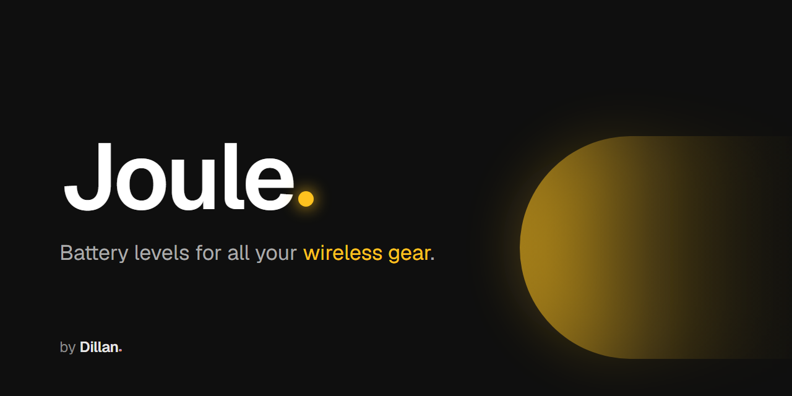
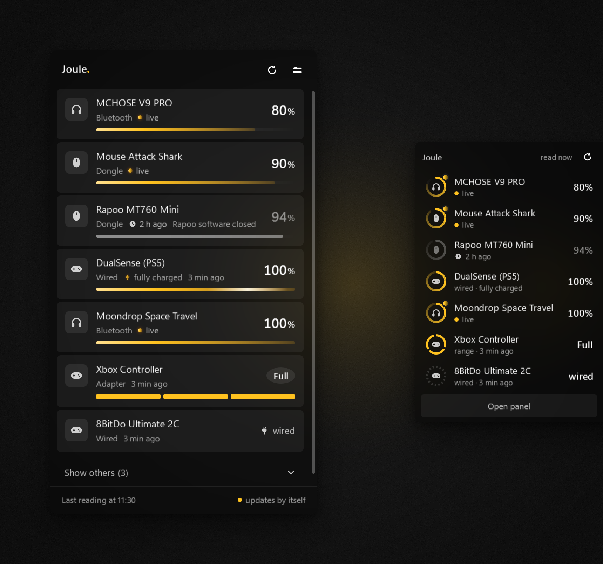

<h1 align="center"></h1>

<p align="center"><strong>Bateria do mouse, fone, controle e teclado sem fio, na bandeja do Windows.</strong></p>

<p align="center">
  <a href="https://github.com/DillanCidral/Joule/releases/latest"></a>
  <a href="https://github.com/DillanCidral/Joule/releases"></a>
  
  <a href="LICENSE"></a>
</p>

<p align="center"> <strong>Português</strong> · <a href="README.md"> English</a></p>

<p align="center">
  <a href="https://github.com/DillanCidral/Joule/releases/latest/download/JouleApp-win-Setup.exe"></a>
</p>

<p align="center"></p>

O Joule é um app pequeno para Windows 11 que fica na bandeja e mostra quanta
bateria ainda têm os seus aparelhos sem fio. É gratuito, de código aberto e
está em **beta**.

## O que ele tem

- **Painel**: clique no ícone da bandeja para ver cada aparelho conectado, do
  mais fraco ao mais forte.
- **Widget de borda**: anéis de bateria na borda da tela. Esconde sozinho e
  some quando um app está em tela cheia.
- **Ícone da bandeja**: mostra de relance se algo está com bateria baixa;
  passe o mouse para ver a bateria de cada aparelho.
- **Aviso ao conectar**: quando um aparelho liga, o Joule mostra a bateria dele,
  no widget ou no aviso do Windows, com som se você quiser.
- **Alerta de bateria baixa**, com o limite que você escolher.
- **Português e inglês**: segue o idioma do Windows, e dá para trocar nas
  Configurações.
- **Resumo depois de atualizar**: quantos aparelhos o Joule acompanhou e quantos
  avisos de bateria baixa deu, contados só no seu PC, e o que mudou na versão.

## Baixar

Baixe o `JouleApp-win-Setup.exe` pelo botão acima ou na
[página de Releases](https://github.com/DillanCidral/Joule/releases), e abra.

- Não precisa de administrador. Instala só para o seu usuário e aparece em
  *Aplicativos instalados*, de onde se desinstala.
- O instalador não tem assinatura digital, então o SmartScreen do Windows vai
  avisar. Clique em **Mais informações** e depois em **Executar assim mesmo**.
- O Joule se atualiza sozinho pelo GitHub Releases e avisa na bandeja quando
  há versão nova.

## Aparelhos suportados

| Aparelho | Conexão | Situação |
|---|---|---|
| Attack Shark R1 | dongle | ✅ conferido |
| Rapoo MT760 Mini | dongle | ✅ conferido |
| DualSense | cabo | ✅ conferido |
| Controles Xbox | adaptador e cabo | ✅ conferido |
| 8BitDo Ultimate 2C | cabo | ✅ conferido |
| Qualquer aparelho Bluetooth cuja bateria o Windows já mostre em *Configurações > Bluetooth* | Bluetooth | ✅ conferido |
| Logitech, Razer, SteelSeries, HyperX e Corsair: mouses, teclados e fones | dongle | 🧪 ainda não testado |
| Umas 20 outras marcas: ATK, VXE, VGN, Pulsar, Dareu, AJAZZ, Lamzu, WLmouse, G-Wolves, Hitscan, K-Snake, Bytech, Motospeed, Keychron, Incott e outros modelos Attack Shark | dongle | 🧪 ainda não testado |

🧪 quer dizer escrito a partir de documentação aberta de protocolo e ainda não
testado em aparelho real. Se você tem um, é o seu relato que confirma. Lista
completa: [docs/aparelhos-suportados.md](docs/aparelhos-suportados.md).

## Meu aparelho não está na lista

Abra **Configurações > Mandar meu aparelho** dentro do Joule. Ele escuta por
30 segundos enquanto você usa o aparelho, mostra o que achou, tira os dados
pessoais (número de série, endereço Bluetooth, nome do PC, nome de usuário) e
salva um `.txt`. Quem manda o arquivo é você, num
[relato no GitHub](https://github.com/DillanCidral/Joule/issues/new/choose) ou
por [e-mail](#contato). Nada sai do seu PC sozinho.

Quer adicionar o aparelho você mesmo? Veja
[docs/adicionar-um-aparelho.md](docs/adicionar-um-aparelho.md).

<details>
<summary><strong>O que o Joule faz com os seus aparelhos</strong></summary>

- Lê quando você abre o app, quando você entra no Windows, quando você clica em
  **Atualizar** e quando você liga ou conecta um aparelho (só esse aparelho, no
  máximo uma vez a cada 10 segundos). Nunca fica perguntando em loop.
- Na maioria dos aparelhos ele só **escuta** o que o dongle ou o cabo já
  mandam, ou lê o número que o próprio Windows guardou (Bluetooth).
- Para algumas marcas pelo dongle (Logitech, Razer, SteelSeries, HyperX,
  Corsair e parte das outras) ele **pergunta** a bateria ao aparelho, só
  depois que você permite aquela marca: a mesma
  pergunta que projetos abertos como Solaar, OpenRazer e HeadsetControl mandam,
  uma vez por leitura. Nunca manda comando que mude configuração. A chave
  **Só escutar**, nas Configurações, corta toda pergunta.
- Nunca mostra número que não leu. Sem dado é "sem dado", nunca "0%".
- Não manda nada para lugar nenhum. O único acesso à internet é a busca de
  atualização no GitHub Releases.

Detalhes: [SECURITY.pt-BR.md](SECURITY.pt-BR.md).

</details>

<details>
<summary><strong>Compilar</strong></summary>

Você precisa de Windows e do [SDK do .NET 8](https://dotnet.microsoft.com/download/dotnet/8.0).

```bash
dotnet build src/BatteryTray -c Debug
```

```bash
dotnet run --project src/BatteryTray -- --demo
```

O `--demo` mostra aparelhos de exemplo sem tocar em hardware nenhum. Mais em
[CONTRIBUTING.pt-BR.md](CONTRIBUTING.pt-BR.md) e
[docs/arquitetura.md](docs/arquitetura.md).

</details>

## Apoiar o Joule

O Joule é grátis e de código aberto. Se ele te ajuda, um café ajuda a mantê-lo
assim: [apoiar o Joule](https://buy.stripe.com/bJeeVe5yq5Pub7bfz8bZe00).

## Contato

- E-mail: dillan.apps@gmail.com
- Instagram: [@dillan.apps](https://www.instagram.com/dillan.apps/)
- YouTube: [@dillanapps](https://www.youtube.com/@dillanapps)

## Licença

[AGPL-3.0](LICENSE). As licenças de terceiros e os projetos abertos cuja
documentação de protocolo tornou o Joule possível estão em
[THIRD-PARTY-NOTICES.md](THIRD-PARTY-NOTICES.md).

O Joule não tem ligação com Logitech, Razer, SteelSeries, HyperX, Corsair,
Sony, Microsoft, 8BitDo nem com outra marca citada aqui. Os nomes e as marcas
pertencem aos seus donos.
