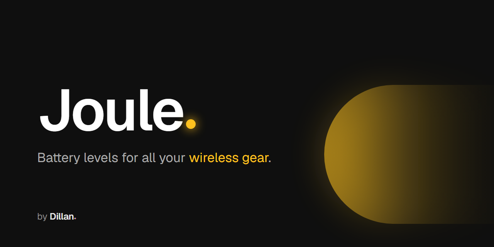

<h1 align="center"></h1>

<p align="center"><strong>Заряд беспроводной мыши, гарнитуры, геймпада и клавиатуры в трее Windows.</strong></p>

<p align="center">
  <a href="https://github.com/DillanCidral/Joule/releases/latest"></a>
  <a href="https://github.com/DillanCidral/Joule/releases"></a>
  
  <a href="LICENSE"></a>
</p>

<p align="center"><a href="README.md">🇭🇰 繁體中文</a> · <a href="README.en.md"> English</a> · <a href="README.pt-BR.md"> Português</a> · <a href="README.fr.md"> Français</a> ·  <strong>Русский</strong></p>

<p align="center">
  <a href="https://github.com/DillanCidral/Joule/releases/latest/download/JouleApp-win-Setup.exe"></a>
</p>

<p align="center"></p>

> Этот перевод сделан автоматически и ждёт проверки носителем языка. Если
> заметите ошибку, откройте issue или pull request: спасибо!

Joule — небольшое приложение для Windows 11, которое живёт в трее и показывает,
сколько заряда осталось у ваших беспроводных устройств. Оно бесплатное, с
открытым кодом и находится в **бета-версии**.

## Что умеет

- **Панель**: щёлкните по значку в трее, чтобы увидеть все подключённые
  устройства, начиная с самого разряженного.
- **Виджет у края экрана**: кольца заряда на краю экрана. Он сам прячется и не
  мешает полноэкранным приложениям.
- **Значок в трее**: сразу видно, не садится ли что-то; наведите курсор, чтобы
  увидеть заряд каждого устройства.
- **Уведомление о подключении**: когда устройство включается, Joule показывает
  его заряд в виджете или в уведомлении Windows, со звуком, если хотите.
- **Предупреждение о низком заряде** с порогом, который вы выбираете.
- **Английский, португальский, французский и русский**: язык Windows
  подхватывается сам, а сменить его можно в Настройках. Французский и русский
  перевели люди, которые пользуются Joule.
- **Зелёный при полной зарядке**: устройства, которые сообщают о зарядке,
  становятся зелёными в виджете и в трее, когда доходят до 100%.
- **Сводка после обновления**: сколько устройств Joule отслеживал и сколько раз
  предупреждал о низком заряде (считается только на вашем ПК), и что нового в
  версии.

## Скачать

Скачайте `JouleApp-win-Setup.exe` кнопкой выше или со
[страницы Releases](https://github.com/DillanCidral/Joule/releases) и запустите.

- Права администратора не нужны. Приложение ставится только для вашего
  пользователя и появляется в *Установленных приложениях*, где его можно удалить.
- У установщика нет цифровой подписи, поэтому Windows SmartScreen предупредит
  вас. Нажмите **Подробнее**, затем **Выполнить в любом случае**.
- Joule обновляется сам через GitHub Releases и сообщает в трее, когда новая
  версия готова.

## Поддерживаемые устройства

| Устройство | Подключение | Статус |
|---|---|---|
| Attack Shark R1 | донгл | ✅ проверено |
| Rapoo MT760 Mini | донгл | ✅ проверено |
| Razer BlackShark V3 | донгл | ✅ проверено |
| Zaopin ZPW MAX (8K) | донгл | ✅ проверено |
| Ресивер AJAZZ 2.4G 8K | донгл | ✅ проверено |
| AULA F75 | кабель (донгл ещё не проверен) | ✅ проверено |
| DualSense | кабель | ✅ проверено |
| Геймпады Xbox | адаптер и кабель | ✅ проверено |
| 8BitDo Ultimate 2C | кабель | ✅ проверено |
| Любое Bluetooth-устройство, заряд которого Windows уже показывает в *Параметры > Bluetooth* | Bluetooth | ✅ проверено |
| Мыши Logitech через LIGHTSPEED (PRO X 2 и другие) и Unifying (MX Master 2S), SteelSeries Arctis 1 и Arctis 7, VXE R1 Pro Max, VGN IO Aurora | донгл | ✅ подтверждено пользователями |
| Logitech, Razer, SteelSeries, HyperX и Corsair: мыши, клавиатуры и гарнитуры | донгл | 🧪 ещё не проверено |
| Около 20 других брендов: ATK, VXE, VGN, Pulsar, Dareu, AJAZZ, Lamzu, WLmouse, G-Wolves, Hitscan, K-Snake, Bytech, Motospeed, Keychron, Incott и другие модели Attack Shark | донгл | 🧪 ещё не проверено |

🧪 означает, что поддержка написана по открытой документации протокола и ещё не
проверена на реальном устройстве. Если оно у вас есть, именно ваш отчёт это
подтвердит. «Подтверждено пользователями» значит, что кто-то прислал запись, где
Joule читает заряд на его собственном ПК. Полный список (на английском):
[docs/supported-devices.md](docs/supported-devices.md).

## Моего устройства нет в списке

Сначала посмотрите [семейства устройств](https://github.com/DillanCidral/Joule/issues?q=is%3Aissue%20is%3Aopen%20label%3Atracking):
если ваше там есть, поставьте 👍 вместо того, чтобы открывать новый issue.
Joule тоже покажет похожие запросы, когда вы будете отправлять свой.

Откройте в Joule **Настройки > Дополнительно > Отправить данные устройства**.
Он слушает 30 секунд, пока вы пользуетесь устройством, показывает, что нашёл,
удаляет личные данные (серийный номер, Bluetooth-адрес, имя ПК, имя
пользователя) и сохраняет файл `.txt`. Отправляете этот файл вы сами, как
[issue на GitHub](https://github.com/DillanCidral/Joule/issues/new/choose) или
по [электронной почте](#контакты). Ничего не уходит с вашего ПК само.

Хотите добавить устройство сами? См.
[docs/adding-a-device.md](docs/adding-a-device.md) (на английском).

<details>
<summary><strong>Что Joule делает с вашими устройствами</strong></summary>

- Он читает заряд, когда вы открываете приложение, входите в Windows, нажимаете
  **Обновить**, подключаете или включаете устройство (только это устройство, не
  чаще раза в 10 секунд) и когда вы открываете панель, если последнее чтение было
  больше часа назад. Он никогда не опрашивает устройства в цикле.
- Для большинства устройств он только **слушает** то, что донгл или кабель и так
  отправляют, или читает число, которое сохранила сама Windows (Bluetooth).
- Для некоторых брендов на донгле (Logitech, Razer, SteelSeries, HyperX, Corsair
  и часть остальных) он **спрашивает** у устройства заряд, только после того как
  вы разрешите этот бренд: тот же запрос, что отправляют открытые проекты вроде
  Solaar, OpenRazer и HeadsetControl, один раз за чтение. Он никогда не
  отправляет команду, меняющую настройки. Переключатель **Только слушать** в
  Настройках отключает все запросы.
- Он никогда не показывает число, которое не прочитал. Нет данных — значит «нет
  данных», а не «0%».
- Он никуда ничего не отправляет. Единственный выход в сеть — проверка
  обновлений в GitHub Releases.

Подробнее (на английском): [SECURITY.md](SECURITY.md).

</details>

<details>
<summary><strong>Сборка из исходников</strong></summary>

Нужны Windows и [.NET 8 SDK](https://dotnet.microsoft.com/download/dotnet/8.0).

```bash
dotnet build src/BatteryTray -c Debug
```

```bash
dotnet run --project src/BatteryTray -- --demo
```

`--demo` показывает примеры устройств, не трогая оборудование. Подробнее (на
английском) в [CONTRIBUTING.md](CONTRIBUTING.md) и
[docs/architecture.md](docs/architecture.md).

</details>

## Спасибо

В версии 0.2.1 есть код и переводы от сообщества:
[@Ali-Fani](https://github.com/Ali-Fani) (Razer BlackShark V3),
[@wrldwideme](https://github.com/wrldwideme) (AULA F75, ресиверы AJAZZ и Zaopin
и русский перевод),
[@TukaLeHibou](https://github.com/TukaLeHibou) (французский перевод), а зелёный
цвет полной батареи появился по идее Daniel Palma. Obrigado — и спасибо всем,
кто прислал запись.

## Поддержать Joule

Joule бесплатный и с открытым кодом. Если он вам помогает, чашка кофе помогает
ему таким и оставаться: [поддержать Joule](https://buy.stripe.com/bJeeVe5yq5Pub7bfz8bZe00).

## Контакты

- Эл. почта: dillan.apps@gmail.com
- Instagram: [@dillan.apps](https://www.instagram.com/dillan.apps/)
- YouTube: [@dillanapps](https://www.youtube.com/@dillanapps)

## Лицензия

[AGPL-3.0](LICENSE). Сторонние лицензии и открытые проекты, чья документация
протоколов сделала Joule возможным, перечислены в
[THIRD-PARTY-NOTICES.md](THIRD-PARTY-NOTICES.md).

Joule не связан с Logitech, Razer, SteelSeries, HyperX, Corsair, Sony,
Microsoft, 8BitDo и другими упомянутыми здесь брендами. Их названия и товарные
знаки принадлежат их владельцам.
